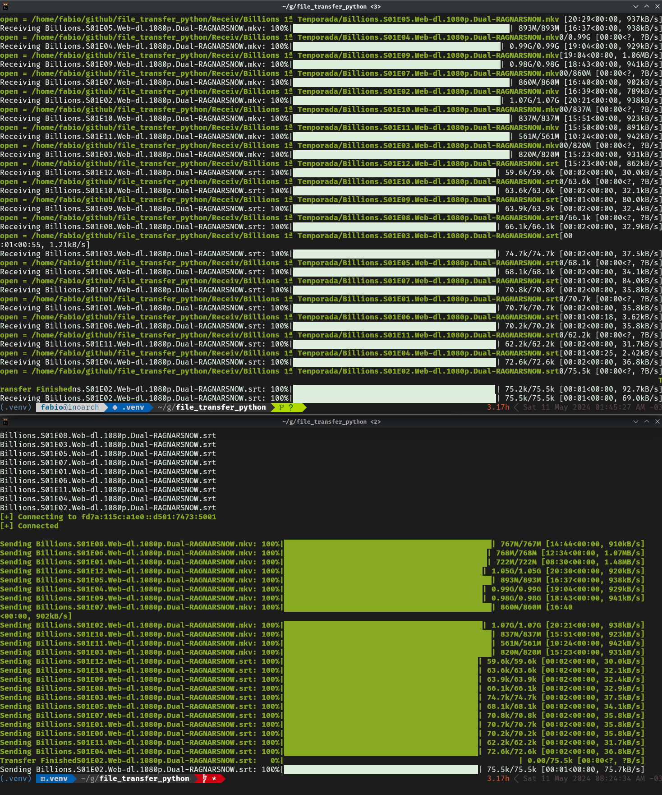

# File Transfer in python using ipv6

This is a simple file transfer program using IPv6 in Python. It uses the `socket` module to open a TCP connection over IPv6 (port 5001) between a sender and a receiver. The sender first announces the number of entries and the total size, then sends each file's metadata followed by its bytes; folders are walked recursively. The receiver writes everything into a `Receiv/` folder. Progress bars use `tqdm`, and a small PyQt5 dialog (`button.py`) can be used to pick a file or folder.

## Usage
clone this repo 
```bash
git clone https://github.com/Gedankenn/file_transfer_python.git
```

Install the requirements
```bash
pip install -r requirements.txt
```

Run the program
```bash
python file_transfer.py send <file or folder> <ipv6 address>   # on the sending machine
python file_transfer.py receive                                 # on the receiving machine
```

Start the receiver first. It listens on the first IPv6 address of its hostname and prints the address to use on the sender. Running the script without arguments shows an interactive menu.

## Screenshots

